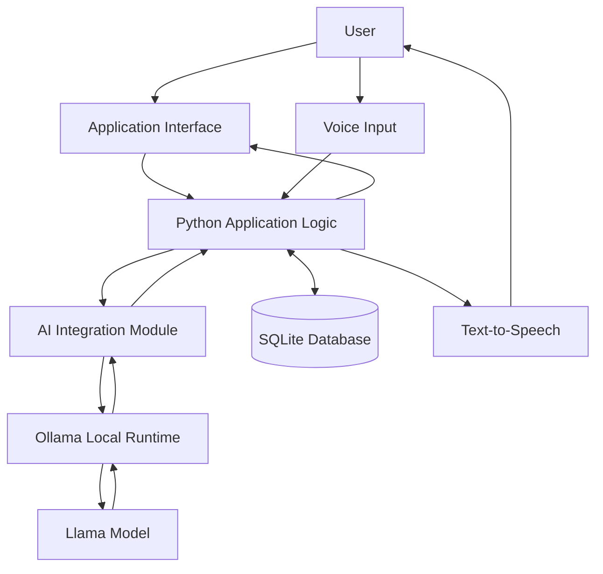
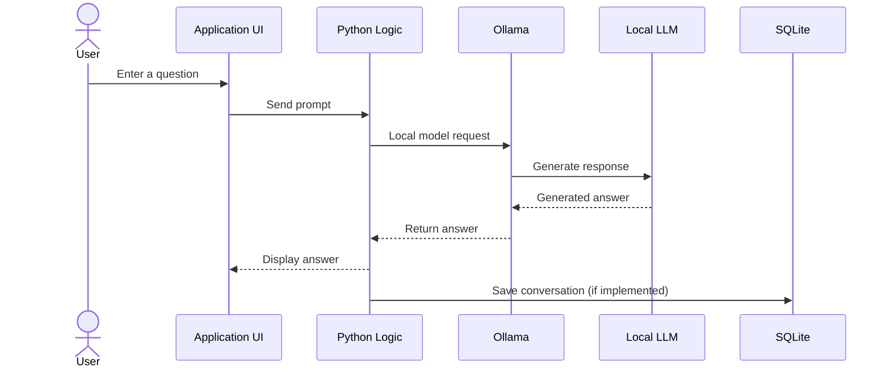
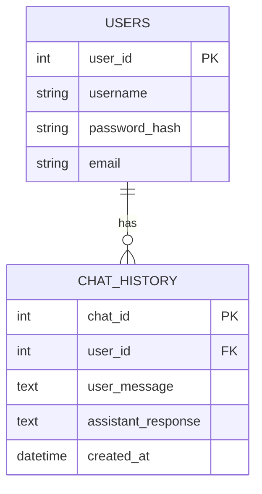

<div align="center">

# 🎙️ Offline AI Assistant

### 🧠 Your private AI companion — powered by locally running language models

**An offline-first AI assistant built with Python, Ollama, and SQLite.**


</div>

---

## 📌 Table of Contents

- [📖 About the Project](#-about-the-project)
- [🎯 Project Objectives](#-project-objectives)
- [✨ Features](#-features)
- [🛠️ Technology Stack](#️-technology-stack)
- [🏗️ System Architecture](#️-system-architecture)
- [🔄 Application Workflow](#-application-workflow)
- [🧠 How the AI Works](#-how-the-ai-works)
- [🗄️ Database](#️-database)
- [📂 Project Structure](#-project-structure)
- [💻 System Requirements](#-system-requirements)
- [⚙️ Installation and Setup](#️-installation-and-setup)
- [▶️ Running the Application](#️-running-the-application)
- [🔒 Privacy and Offline Operation](#-privacy-and-offline-operation)
- [🧪 Testing Checklist](#-testing-checklist)
- [⚠️ Limitations](#️-limitations)
- [🚀 Future Enhancements](#-future-enhancements)
- [🧩 Troubleshooting](#-troubleshooting)
- [🎤 Interview Explanation](#-interview-explanation)
- [👨‍💻 Author](#-author)

---

## 📖 About the Project

**Offline AI Assistant** is a Python-based application that allows users to interact with an AI language model running locally on their computer. It is designed to provide AI-generated answers while keeping model inference and application data on the user's device.

The application uses **Ollama** to run a locally installed Large Language Model (LLM), such as Llama. Python connects the application interface to the local model, while **SQLite** can be used to store user information and conversation history.

Depending on the enabled features, users can communicate with the assistant through text and voice. Speech recognition can convert spoken questions into text, and text-to-speech can read the assistant's response aloud.

The project focuses on three main ideas:

- 🔐 **Privacy:** Keep prompts and locally stored conversation data on the user's device.
- 📴 **Offline access:** Use a model that has already been downloaded and installed locally.
- 🤖 **Convenience:** Provide a simple way to ask questions and receive AI-generated responses.

> **Important:** “Offline” means the application can generate responses without sending prompts to a cloud AI service after the required software, model files, and voice resources have been installed. Initial downloads and installation may require an internet connection.

## 🎯 Project Objectives

1. Develop an AI assistant that can use a locally running language model.
2. Reduce dependence on cloud-based AI services for ordinary question-and-answer interactions.
3. Provide a straightforward interface for sending prompts and viewing responses.
4. Support voice input and spoken responses where the required speech components are configured for offline use.
5. Use a local database such as SQLite to manage application data and conversation history.
6. Explore practical integration of Python, local LLMs, speech technologies, and database operations.

## ✨ Features

### 🧠 Local AI Responses
- Connects to a locally running model through Ollama.
- Sends user prompts to the selected local model.
- Displays the generated response in the application.
- Does not require a cloud AI API for local model inference.

### 🎤 Voice Input
- Uses speech recognition to convert spoken input into text.
- Passes the recognized text to the AI assistant.
- Requires a speech-recognition engine and language resources that support offline operation if the feature is to work without internet access.

### 🔊 Voice Output
- Uses text-to-speech technology to read generated answers aloud.
- Can use `pyttsx3` for local speech output.
- Voice output can be made optional so users can read responses without hearing them.

### 💬 Text Interaction
- Allows users to type questions and receive AI-generated answers.
- Supports ordinary question-and-answer conversations.
- Keeps the interaction flow simple and accessible.

### 🗄️ Local Data Storage
- Uses SQLite for local data storage.
- Can store user details and conversation history, depending on the implemented database tables.
- Does not require a separate database server.

### 🔐 Privacy-Focused Design
- Uses a local LLM runtime for inference.
- Keeps locally stored application data on the device.
- Avoids sending prompts to a cloud AI provider when the application is configured to use only the local model.

### 👤 User Accounts and History
- User registration, login, profile management, and chat-history features may be included where implemented.
- These features depend on the project's actual authentication and database modules.

> **Feature accuracy:** Keep only the features that are implemented and tested in your current version. In particular, speech recognition is not automatically offline just because the LLM is local.

## 🛠️ Technology Stack

| Technology | Role in the Project |
|---|---|
| 🐍 **Python** | Main programming language and application logic |
| 🦙 **Ollama** | Runs and manages the local language model |
| 🧠 **Llama** | Large Language Model used to generate responses |
| 🗄️ **SQLite** | Local relational database |
| 🎤 **SpeechRecognition** | Speech-to-text integration, depending on the configured recognition engine |
| 🔊 **pyttsx3** | Text-to-speech output |
| 🖥️ **Streamlit or desktop UI toolkit** | User interface, depending on the version being run |

### 🔍 Why These Technologies?

- **Python:** Offers libraries for application development, AI integration, database access, and speech processing.
- **Ollama:** Provides a convenient way to download and run supported language models locally.
- **Llama:** Generates natural-language responses to user prompts.
- **SQLite:** Stores structured information in a local database file without requiring a separate database server.
- **SpeechRecognition:** Provides a Python interface for speech-recognition engines.
- **pyttsx3:** Converts text into spoken audio using locally available speech engines.

## 🏗️ System Architecture

The following diagram shows the high-level design. The exact interface and modules depend on the version of the project.



### 🧩 Main Components

| Component | Responsibility |
|---|---|
| Application interface | Accepts user input and displays responses |
| Python application logic | Coordinates the request and response process |
| AI integration | Sends prompts to the local Ollama service |
| Ollama runtime | Loads and runs the selected local model |
| Llama model | Generates the AI response |
| SQLite database | Stores application data and history when implemented |
| Voice input | Converts speech into text when configured |
| Voice output | Reads responses aloud when enabled |

## 🔄 Application Workflow

### 💬 Text-Based Interaction

1. The user opens the application.
2. The user enters a question in the input area.
3. Python receives the prompt.
4. The AI integration module sends the prompt to the local Ollama service.
5. Ollama passes the request to the selected Llama model.
6. The model generates a response.
7. The response is returned to the Python application.
8. The application displays the answer.
9. If chat-history storage is implemented, the conversation is saved in SQLite.



### 🎤 Voice-Based Interaction

1. The user speaks into a microphone.
2. The configured speech-recognition engine processes the audio.
3. Recognized words are converted into text.
4. The text is sent to the local AI model through Ollama.
5. The generated answer is displayed.
6. If voice output is enabled, text-to-speech reads the answer aloud.

## 🧠 How the AI Works

### 🦙 What is Ollama?

Ollama is a tool for running supported large language models on a local computer. It manages model downloads and provides a local interface that an application can use to send prompts and receive generated responses.

### 🤖 What is Llama?

Llama is a family of large language models developed by Meta. A Llama model can understand prompts and generate text responses. The model used by this project must be installed locally and supported by the installed Ollama version.

### 🔄 What happens when a user asks a question?

- The application receives the user's prompt.
- Python sends the prompt to Ollama.
- Ollama runs inference using the selected local model.
- The model generates a response token by token.
- The generated text is returned to the application.

### 🧩 Does this project train its own AI model?

No. The application integrates a pre-trained language model through Ollama. It uses the installed model to generate responses; it does not train a new Llama model as part of normal application usage.

## 🗄️ Database

The project uses **SQLite**, a lightweight relational database that stores information in a local database file.

### 📌 Possible Database Uses

Depending on the implemented features, SQLite can store:

- User account information.
- Conversation records.
- User prompts.
- AI-generated responses.
- Conversation timestamps.

### 🧱 Example Database Design

The following is an illustrative schema. Update it to match the tables and columns in your actual `database.py` file.



**Database note:** Store password hashes rather than plain-text passwords. Use parameterized SQL queries to help protect against SQL injection.

## 📂 Project Structure

A possible organization for the project is shown below. Your actual repository may contain fewer or differently named files; keep the README synchronized with the code.

```text
Offline-AI-Assistant/
│
├── app.py                  # Application entry point
├── ai.py                   # Ollama and LLM integration
├── voice_input.py          # Speech input handling
├── voice_output.py         # Text-to-speech handling
├── database.py             # SQLite connection and queries
├── auth.py                 # User authentication (if implemented)
├── history.py              # Conversation-history operations (if implemented)
├── config.py               # Application configuration (if implemented)
├── requirements.txt        # Python dependencies
├── README.md               # Project documentation
│
└── database/
    └── assistant.db        # Local database file (created by the app, if used)
```

### 📄 Important Files

- **`app.py`** — Starts the application and connects the interface to the application logic.
- **`ai.py`** — Handles communication with Ollama and retrieves the model's response.
- **`voice_input.py`** — Contains voice-input and speech-recognition logic, if included.
- **`voice_output.py`** — Contains text-to-speech logic, if included.
- **`database.py`** — Handles SQLite database connections and database operations, if included.
- **`requirements.txt`** — Lists the Python packages needed by the project.

## 💻 System Requirements

### 🖥️ Hardware

| Component | Suggested Requirement |
|---|---|
| Processor | Intel Core i3/i5 or equivalent; a stronger CPU is recommended |
| RAM | 8 GB minimum; more RAM is recommended for larger models |
| Storage | At least 10 GB of free space, depending on the model |
| Microphone | Required for voice input |
| Speakers or headphones | Required for voice output |

### 🧰 Software

- Windows 10/11, Linux, or macOS, depending on library support.
- Python 3.10 or a compatible version for the project's dependencies.
- Ollama installed and running.
- A compatible LLM downloaded locally.
- Python packages listed in `requirements.txt`.

> Model performance depends on the model size and your computer's available memory and processing power. The requirements above are general guidance, not a guarantee that every model will run smoothly.

## ⚙️ Installation and Setup

### 1️⃣ Download or Clone the Repository

```bash
git clone YOUR_REPOSITORY_URL
cd Offline-AI-Assistant
```

Replace `YOUR_REPOSITORY_URL` with the actual Git repository URL.

### 2️⃣ Create a Virtual Environment (Recommended)

```bash
python -m venv venv
```

Activate it on Windows:

```bash
venv\Scripts\activate
```

On macOS or Linux:

```bash
source venv/bin/activate
```

### 3️⃣ Install Python Dependencies

```bash
pip install -r requirements.txt
```

If your repository does not yet contain a `requirements.txt` file, create one using the packages your code actually imports. Do not install packages that the project does not use.

### 4️⃣ Install and Start Ollama

Install Ollama using its official installer. Then open a terminal and check that it is available:

```bash
ollama --version
```

### 5️⃣ Download a Local Model

For example, if the model tag you intend to use is `llama3`:

```bash
ollama pull llama3
```

The model name in your Python code must match a model tag installed on your computer. If your project uses a different Llama version or another model, use that exact tag instead.

### 6️⃣ Verify the Model

```bash
ollama list
```

You can test the model from the terminal:

```bash
ollama run llama3
```

Type a question to check that the model responds. Exit the interactive session when finished.

## ▶️ Running the Application

Run the entry-point file used by your project:

```bash
python app.py
```

If your project uses a different entry point, replace `app.py` with the correct filename.

### 📴 Running Without Internet

After setup is complete:

1. Confirm Ollama is installed and the required model is already downloaded.
2. Confirm the Ollama service is running.
3. Disconnect from the internet for a test.
4. Start the application.
5. Submit a question and check whether the local model responds.
6. Test voice input separately if it is part of your project.

A successful local LLM test does not by itself prove that every speech-recognition feature works offline. Verify the configured speech engine independently.

## 🔒 Privacy and Offline Operation

Privacy is an important design goal of this project.

- **Local inference:** Prompts are sent to the local Ollama service when configured for local model use.
- **Local storage:** SQLite data is stored on the computer where the application runs.
- **No cloud AI dependency:** Local response generation does not need a remote AI API.
- **User responsibility:** Protect the computer and database file, and avoid storing sensitive information unnecessarily.

The project should not be described as completely internet-independent during installation unless all required installers, model files, Python packages, and voice resources are already available locally.

## 🧪 Testing Checklist

Use this checklist to verify the features that are present in your implementation.

- [ ] Application starts without errors.
- [ ] Ollama is installed and running.
- [ ] The configured model appears in `ollama list`.
- [ ] A text prompt receives a response from the local model.
- [ ] The application handles an unavailable Ollama service gracefully.
- [ ] Voice input works, if implemented.
- [ ] Voice input works without internet, if offline speech recognition is claimed.
- [ ] Voice output works, if implemented.
- [ ] Chat history is saved and retrieved, if implemented.
- [ ] User registration and login work, if implemented.
- [ ] The application can answer a test prompt after the internet is disconnected.

## ⚠️ Limitations

- Response speed depends on the model size and computer hardware.
- Larger models may require more RAM or a supported GPU.
- Local LLM responses can be inaccurate, incomplete, or outdated.
- The model does not automatically know live internet information.
- Speech-recognition libraries may use online services unless configured with a suitable offline engine.
- Initial installation and model downloads generally require internet access.
- The actual available features depend on the current project implementation.

## 🚀 Future Enhancements

Potential improvements include:

- 💻 Build a native Windows desktop interface so the application opens in its own window without requiring a browser.
- 🎙️ Add or improve fully offline speech recognition.
- 🌍 Add multilingual voice input and output.
- 🧠 Allow users to select between multiple locally installed LLMs.
- 📜 Improve conversation search, organization, and history management.
- 🔐 Strengthen account security and local data protection.
- ⚡ Add streaming responses and background processing to keep the interface responsive.
- 📦 Package the application with a Windows installer for easier setup.

## 🧩 Troubleshooting

| Problem | What to Check |
|---|---|
| `ollama` command not found | Confirm Ollama is installed and available in the system PATH. Restart the terminal after installation. |
| Cannot connect to Ollama | Make sure the Ollama application/service is running. |
| Model not found | Run `ollama list` and check that the model tag matches the one in your code. |
| Slow responses | Try a smaller model or close other memory-intensive applications. |
| Python module not found | Activate the correct virtual environment and install the required packages. |
| Microphone not detected | Check OS microphone permissions and the selected input device. |
| No voice output | Check the system audio output and the configured text-to-speech engine. |
| Database error | Check the database path, file permissions, and SQL table initialization. |

## 🎤 Interview Explanation

**Short project explanation:**

“My project is Offline AI Assistant, a Python-based application that uses Ollama to run a pre-trained Llama language model locally. Users can submit questions and receive AI-generated responses without sending prompts to a cloud AI service. I use SQLite for local data storage and integrate speech input and output where configured. The main objective is to provide a privacy-focused AI assistant that can work without an internet connection after the required model and dependencies have been installed.”

**What I learned:**

- Integrating a pre-trained LLM into a Python application.
- Connecting Python with a locally running Ollama model.
- Working with SQLite and local data storage.
- Understanding speech-to-text and text-to-speech integration.
- Debugging application, model-connection, and dependency issues.

## 👨‍💻 Author

**Sompalli Sivaiah**

🎓 Master of Computer Applications (MCA)

💡 Interested in Python, Java Full Stack Development, and AI-powered applications.

---

<div align="center">

### ⭐ If you find this project interesting, consider giving the repository a star!

**Built with Python, local AI, and a focus on privacy.**

</div>
